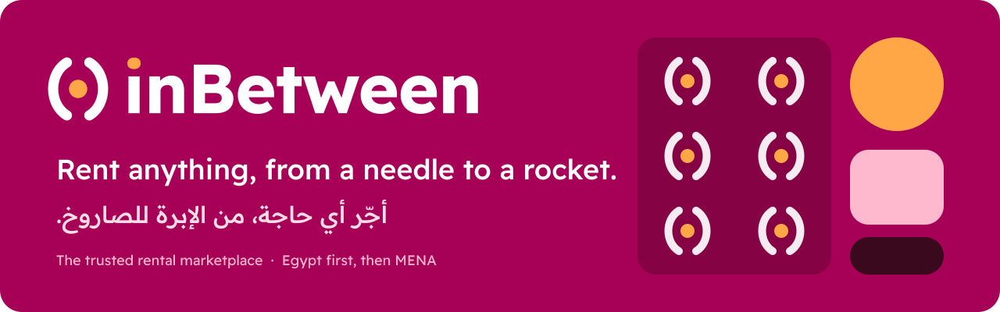
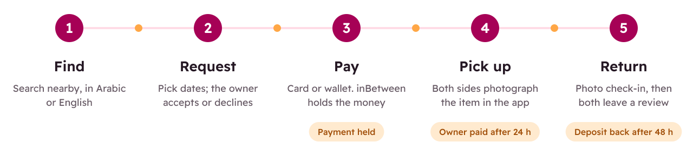
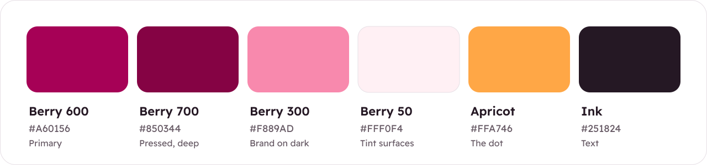

<div align="center">



<br><br>

[](https://github.com/Ziad-irl/inbetween/actions/workflows/ci.yml)


**[Vision](docs/product/vision.md)** · **[Roadmap](docs/product/roadmap.md)** · **[Architecture](docs/architecture/overview.md)** · **[Brand](docs/brand/README.md)** · **[Get started](#quick-start)**

</div>

---

**inBetween** is a rental marketplace where people and businesses rent out the things they own, and anyone nearby can rent them by the hour, day, week or month. inBetween sits in between: it holds the payment and the deposit until each side has done their part, so you can trust a stranger with your things.

We're launching in **Egypt** (Arabic first, with English) and then expanding across **MENA**.

## Why inBetween

| | The problem today | With inBetween |
| --- | --- | --- |
| **Owners** | Cameras, tools, tents and generators sit idle. Renting them out on Facebook or WhatsApp comes with no guaranteed payment, no deposit and no help when something breaks. | Verified renters, a deposit held for you, photo records at handover, and a payout you can count on. |
| **Renters** | Buy something you need for two days, or search scattered groups and hope the seller is honest. | Search nearby in Arabic or English, see the full price up front, and pay safely. The money only moves when you get the item. |
| **Rental shops** | Bookings come by phone, contracts are on paper, payment is in cash, and there's no shared place where customers can find you. | A free shop page, a booking calendar, collected payments and deposits, and new customers. |

## How it works

<picture>
  <source media="(prefers-color-scheme: dark)" srcset=".github/assets/booking-flow-dark.svg">
  
</picture>

The apricot dot in our logo stands for the money in the middle. The renter pays inBetween, and we hold the payment until pickup is confirmed. The owner is paid 24 hours later. The deposit goes back 48 hours after the return, unless the owner reports damage.

## Trust, built in

| | |
| --- | --- |
| **Held payments** | Rental payments go into escrow and are tracked on a double-entry ledger. Nobody is paid before the handover. |
| **Security deposits** | Held on the renter's card, or in escrow, and released automatically when there is no claim. |
| **Photo handovers** | At pickup and at return, both sides take photos in the app, timestamped and signed off by both. |
| **Verified people** | Every account has a verified phone number. Higher-value rentals also need a national ID and selfie check. Reviews go both ways. |
| **Needle to rocket** | Each category has a risk tier that sets the rules: an optional deposit for books and party supplies, a required ID and deposit for cameras, and stricter rules for vehicles and heavy equipment. |
| **Fair disputes** | Damage claims are decided by a person on our team, using the handover photos and the booking timeline. |

## Business model

inBetween earns a percentage of every booking, split between a renter service fee and an owner commission. We never hold inventory. Later revenue lines are an **inBetween Pro** plan for rental shops (lower commission, stock management, instant booking, analytics), an optional **damage waiver** for renters, and **courier delivery**. The launch plan is supply first: we sign up rental shops in Cairo before opening to renters, starting with cameras and creator gear plus event and party gear.

## Roadmap

| Milestone | Goal | Status |
| --- | --- | --- |
| **M0** Foundation | The whole stack runs locally and CI is green | In progress |
| **M1** Identity & catalog | Sign-up, profiles, business accounts, listings and search | Planned |
| **M2** Booking & payments | Book, pay, hand over and return, then the owner gets paid | Planned |
| **M3** Trust & safety + ops | ID checks, reviews, disputes, admin console, payouts | Planned |
| **M4** Private beta, Cairo | Onboard the first rental shops and owners, then open to renters | Planned |
| **M5** Growth | More categories and cities, the Pro plan, delivery | Planned |

Details: [docs/product/roadmap.md](docs/product/roadmap.md) · Scope of the first release: [docs/product/mvp-scope.md](docs/product/mvp-scope.md)

---

## For developers

### Tech stack

| Layer | Choice |
| --- | --- |
| Web app | Next.js 16 (App Router, React 19), Tailwind CSS 4, next-intl (Arabic right-to-left + English) |
| API | NestJS 11 as a modular monolith, REST + OpenAPI |
| Database | PostgreSQL 17 + PostGIS, Prisma ORM |
| Cache and queues | Redis, with BullMQ for background jobs |
| Object storage | S3-compatible (SeaweedFS locally, S3 or R2 in production) |
| Payments | Paymob (cards, wallets, Fawry kiosks, InstaPay) behind a provider interface |
| Tooling | pnpm workspaces, Turborepo, TypeScript 5.9, ESLint, Prettier, Vitest / Jest, GitHub Actions |

The reasoning behind each choice is in the [Architecture Decision Records](docs/adr/).

### Repository layout

```
apps/
  api/          NestJS API (modular monolith) + Prisma schema
  web/          Next.js web app (Arabic and English, right-to-left)
packages/
  shared/       Domain types, zod schemas, booking state machine, pricing, money
docs/
  product/      Vision, MVP scope, roadmap
  architecture/ System overview, domain model, booking, payments, trust & safety, security, deployment
  adr/          Architecture Decision Records
  brand/        Logo files, colours, typography, voice
  development/  Getting started, conventions
infra/          Local infrastructure helpers
```

### Quick start

You need Node.js 24 (see `.nvmrc`), pnpm 10 (run `corepack enable`) and Docker.

```bash
cp .env.example .env
docker compose up -d          # Postgres + PostGIS, Redis, S3 (SeaweedFS), Mailpit
pnpm install
pnpm db:migrate               # apply Prisma migrations
pnpm db:seed                  # seed the category tree
pnpm dev                      # api on :4000, web on :3000
```

| Service | URL |
| --- | --- |
| Web app (redirects to `/ar`) | http://localhost:3000 |
| API docs (Swagger) | http://localhost:4000/docs |
| Health check | http://localhost:4000/api/health |
| Mailpit (dev inbox) | http://localhost:8025 |

Full setup notes: [docs/development/getting-started.md](docs/development/getting-started.md)

### Documentation

- **Product:** [vision](docs/product/vision.md) · [MVP scope](docs/product/mvp-scope.md) · [roadmap](docs/product/roadmap.md)
- **Architecture:** [overview](docs/architecture/overview.md) · [domain model](docs/architecture/domain-model.md) · [booking lifecycle](docs/architecture/booking-lifecycle.md) · [payments & escrow](docs/architecture/payments-and-escrow.md) · [trust & safety](docs/architecture/trust-and-safety.md) · [security](docs/architecture/security.md) · [deployment](docs/architecture/deployment.md)
- **Decisions:** [ADR index](docs/adr/README.md)
- **Brand:** [logo, colour, type and voice](docs/brand/README.md)

## Brand

<a href="docs/brand/README.md"></a>

The symbol **( • )** is two people with the thing they trust each other with in the middle. The logo files, colour tokens, the [Readex Pro](https://fonts.google.com/specimen/Readex+Pro) type family and the voice guide are all in [docs/brand](docs/brand/README.md).

## Contributing

Read [CONTRIBUTING.md](CONTRIBUTING.md) before opening a pull request. To report a security issue, follow [SECURITY.md](SECURITY.md) and don't open a public issue.

## License

No license has been chosen yet. Until one is added, all rights are reserved by the authors.

<br>

<div align="center">
  
  <br>
  <sub><b>inBetween</b> · إن بيتوين · Egypt first, then MENA</sub>
</div>
