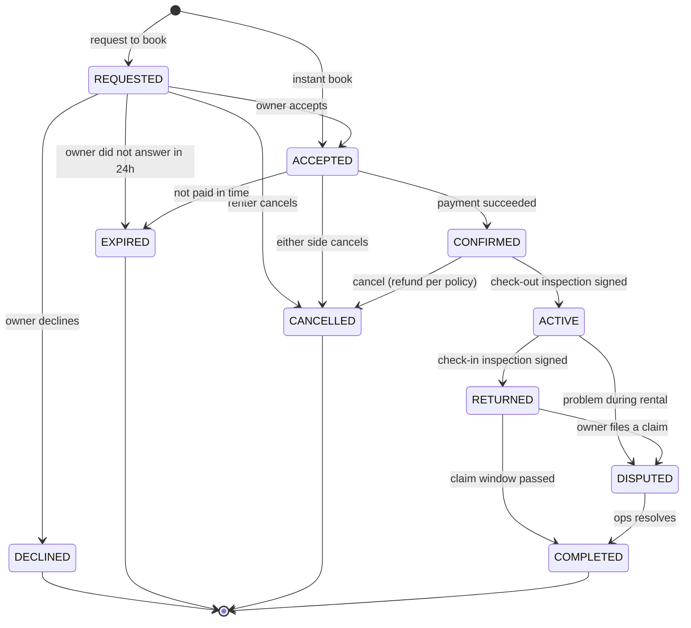

# Booking lifecycle

The state machine lives in [`packages/shared/src/booking/state-machine.ts`](../../packages/shared/src/booking/state-machine.ts) and is the only allowed way to change `Booking.status`.

## States

| State | Meaning | Money |
| --- | --- | --- |
| `REQUESTED` | Renter asked; owner must answer within 24h | Nothing charged |
| `ACCEPTED` | Owner accepted (or instant book); renter must pay within 1h | Dates held (`BOOKING_HOLD`) |
| `CONFIRMED` | Paid | Rental + fees in escrow; deposit held |
| `ACTIVE` | Item handed over (check-out inspection) | Rental portion released to owner 24h later |
| `RETURNED` | Item back (check-in inspection) | Deposit still held during the 48h claim window |
| `DISPUTED` | Claim or problem under review | Deposit frozen until resolution |
| `COMPLETED` | Done | Deposit released or captured per outcome; reviews open |
| `DECLINED` / `EXPIRED` / `CANCELLED` | Terminal | Holds released, refunds per policy |

## Rules

- Transitions are checked with `assertTransition(from, to)`; illegal transitions throw.
- Every transition runs in a database transaction that updates the booking with an optimistic check (`WHERE id = ? AND status = <from>`), inserts a `BookingStatusEvent`, adjusts availability blocks, posts ledger entries if money moves, and writes an `OutboxEvent`.
- Timers (`REQUESTED` 24h, `ACCEPTED` 1h, `RETURNED` 48h) are delayed BullMQ jobs. A sweeper job also re-checks overdue bookings every few minutes, so a lost job never leaves a booking stuck.
- Both sides can trigger handover steps only from the app with photos; ops can override with a reason (audited).

## Double-booking prevention

1. `ACCEPTED` inserts a `BOOKING_HOLD` block; `CONFIRMED` converts it to `BOOKING`.
2. The exclusion constraint on `AvailabilityBlock` rejects overlapping ranges for the same `(listingId, unitIndex)`.
3. The API catches the constraint violation and answers `409 Conflict` with code `BOOKING_DATES_UNAVAILABLE`.
4. Buffers (cleaning or transport time) are added to the block range, not the booking range.

## Cancellation policies

| Policy | Renter cancels | Owner cancels |
| --- | --- | --- |
| Flexible | Full refund up to 24h before start; 50% after | Full refund to renter; owner penalty and a cancellation mark on their profile |
| Moderate | Full refund up to 72h before start; 50% after | Same |
| Strict | 50% refund up to 7 days before; none after | Same |

The renter service fee is refundable only when the owner cancels or within a 1h grace period after booking. Policy rules are data in `packages/shared`, so the quote shown to the renter and the refund computed by the API come from the same code.
