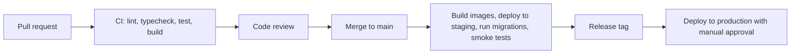

# Deployment and operations

## Environments

| Env | Purpose | Data |
| --- | --- | --- |
| `local` | Developer machines via Docker Compose | Seed data |
| `preview` | Per-PR web previews | Shared staging API |
| `staging` | Integration, QA, Paymob test mode | Synthetic data |
| `production` | Live | Real data, backups, PITR |

## Target hosting (MVP)

Keep operations simple while staying close to users in Egypt:

- **Compute:** containers on AWS ECS Fargate in `me-central-1` (UAE) or `eu-central-1`, chosen by latency from Cairo and data-residency advice. Alternatives considered: Fly.io, Render, Railway (simpler, less control over region).
- **Database:** Amazon RDS for PostgreSQL 17 with PostGIS, Multi-AZ, point-in-time recovery, 14-day backups.
- **Redis:** ElastiCache (or Upstash for staging).
- **Storage:** S3 (or Cloudflare R2) with a CDN (CloudFront/Cloudflare) for public images.
- **Web:** Next.js in a container on the same cluster, or Vercel if the team prefers managed previews.
- **DNS, WAF, CDN:** Cloudflare.

Infrastructure as code: Terraform in `infra/terraform` (M0 task).

## Containers

One image per app:

- `api`: runs `node dist/main.js`; the same image runs the worker with `node dist/worker.js`.
- `web`: Next.js standalone output.

Migrations run as a one-off task (`prisma migrate deploy`) before a new API version starts.

## CI/CD

## Observability

- Logs: JSON to stdout, collected by CloudWatch or Grafana Loki
- Metrics and traces: OpenTelemetry to Grafana Cloud (or similar)
- Errors: Sentry for web and API
- Uptime: external checks on `/api/health` and key pages
- Business alerts: failed webhooks, ledger imbalance, payout batch failures, stuck bookings

## Backups and recovery

- RPO 5 minutes (PITR), RTO 1 hour for the MVP
- Restore drills each quarter
- Object storage versioning on the KYC and inspection buckets
