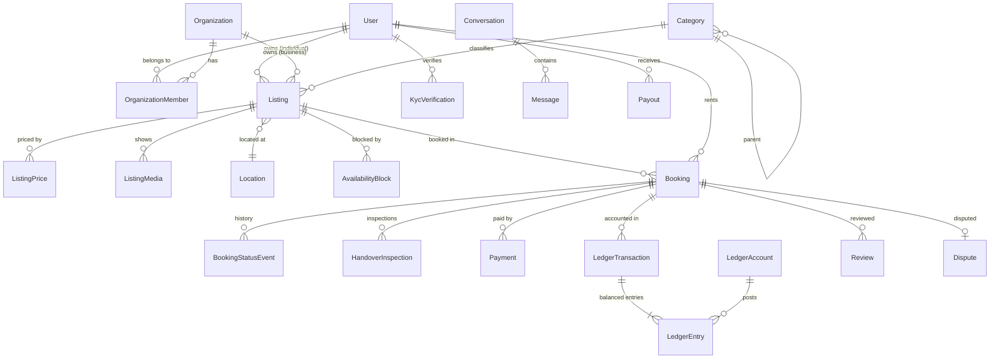

# Domain model

The source of truth is [`apps/api/prisma/schema.prisma`](../../apps/api/prisma/schema.prisma). This page explains the main entities and the reasoning behind them.

## Entity relationships

## Key modelling decisions

### Owners are either a user or an organization
A listing has exactly one of `ownerUserId` or `ownerOrgId`, enforced by a `CHECK` constraint. Payouts, reviews and the "owner" side of a booking follow the same rule. Business staff act on behalf of the organization according to their `OrganizationMember.role`.

### Categories carry the rules
`Category` is a tree (`parentId`) with names in Arabic and English, a JSON `attributesSchema` (for example a camera has `brand`, `mount`, `megapixels`), and a `riskTier` that drives deposits, KYC level and moderation. Child categories inherit the tier unless they override it.

### Prices are a table, not columns
`ListingPrice(unit, amountMinor)` with `unit` in `HOUR | DAY | WEEK | MONTH`. A needle is priced per day; a crane per hour or per month. The quote engine picks the cheapest valid combination for the requested duration (see `packages/shared/src/booking/pricing.ts`).

### Money is `BigInt` minor units
All amounts are stored as `BigInt` piastres (1 EGP = 100 piastres) with a currency column. `Int` would cap at about 21 million EGP, which a rocket (or a month of crane rental) can exceed.

### Availability is enforced by the database
`AvailabilityBlock` rows (`OWNER_BLOCK`, `BOOKING_HOLD`, `BOOKING`, `MAINTENANCE`) store a time range per listing unit. A Postgres exclusion constraint (`btree_gist`, `tstzrange && ...`) makes overlapping blocks for the same unit impossible, so two concurrent bookings cannot both succeed. For listings with `quantity > 1`, each block is assigned a `unitIndex`. The constraint is added in a raw SQL migration because Prisma can't express it.

### Bookings snapshot everything
A booking copies the price breakdown, deposit, cancellation policy and owner at creation time, so later listing edits never change an existing booking. Every status change appends a `BookingStatusEvent`.

### Ledger instead of balance columns
Escrow, fees, refunds and payouts are recorded as balanced `LedgerTransaction`s with two or more `LedgerEntry` rows that sum to zero. Balances are derived from entries. See [payments and escrow](payments-and-escrow.md).

### Locations are approximate until booked
`Location` stores exact `latitude`/`longitude` plus a PostGIS `geography(Point, 4326)` column (added via raw SQL) for radius search. Public APIs return a rounded position (about 500 m) until a booking is confirmed.

### Outbox and audit log
`OutboxEvent` records domain events in the same transaction as the change. `AuditLog` records security-relevant and ops actions (who, what, when, from where).

## Shared vs. database enums

Enums exist both in Prisma (for the database) and in `packages/shared` (for web, mobile and validation). The shared package is the contract for clients; a unit test in the API checks that both enum sets match.
