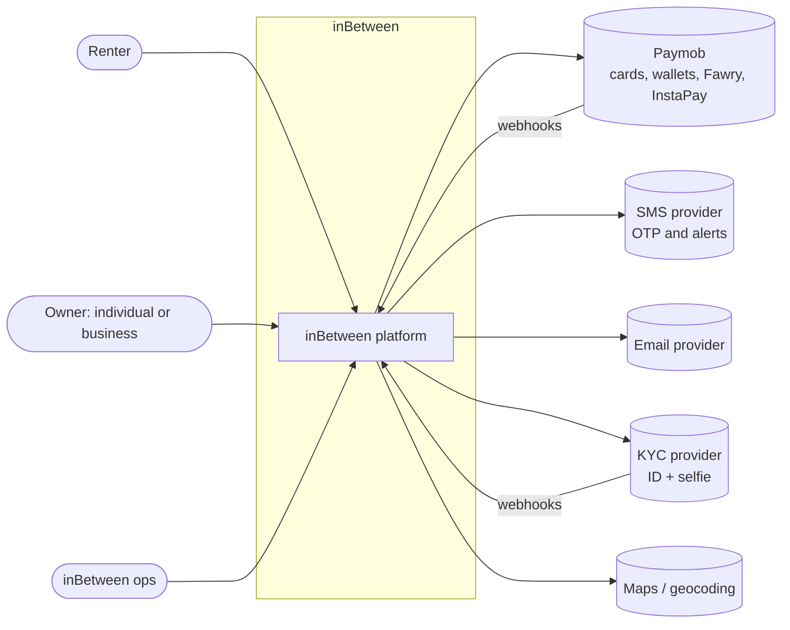
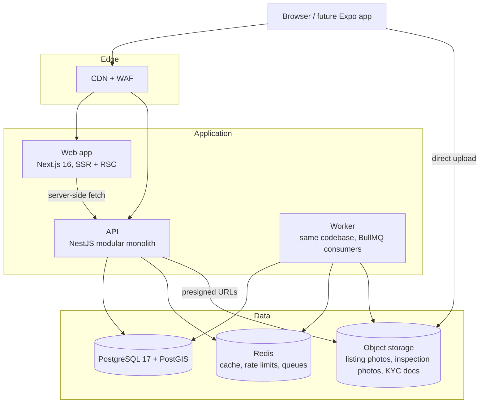
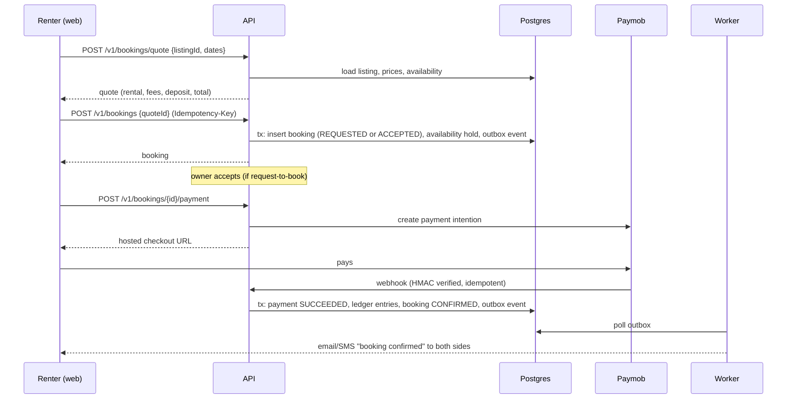

# Architecture overview

## Guiding principles

1. **Modular monolith first.** One deployable API with strict module boundaries. Split a module into a service only when scaling or team ownership requires it ([ADR-0003](../adr/0003-modular-monolith.md)).
2. **Money and bookings are correct before they are fast.** Database constraints, a double-entry ledger, idempotent webhooks and a single state machine.
3. **One language end to end.** TypeScript across web, API and shared domain code ([ADR-0002](../adr/0002-typescript-monorepo.md)).
4. **Arabic first.** RTL and Arabic search are part of the core design ([ADR-0006](../adr/0006-i18n-rtl.md)).
5. **Providers behind interfaces.** Payments, SMS, KYC, storage and search can be swapped without touching domain code.

## System context (C4 level 1)

## Containers (C4 level 2)

- **Web** renders pages on the server for SEO (listing and search pages must be indexable) and calls the API. It holds no business logic.
- **API** exposes versioned REST endpoints (`/api/v1/...`) documented with OpenAPI. The same image runs as **worker** with a different entrypoint to process queues (notifications, booking expiry, payout batches, image processing, outbox publishing).
- **Postgres** is the system of record, including the ledger. PostGIS handles location search.
- **Redis** handles caching, rate limiting, OTP throttling and BullMQ queues.
- **Object storage**: clients upload directly with presigned URLs. KYC documents go to a separate private bucket with stricter access.

## API modules (bounded contexts)

| Module | Owns | Key tables |
| --- | --- | --- |
| `identity` | Users, auth, sessions, OTP, roles | `User`, `Session` |
| `organizations` | Business accounts and members | `Organization`, `OrganizationMember` |
| `catalog` | Categories, listings, media, pricing, availability | `Category`, `Listing`, `ListingPrice`, `ListingMedia`, `AvailabilityBlock`, `Location` |
| `search` | Search queries and ranking (reads catalog) | Postgres FTS indexes / later a search engine |
| `booking` | Quotes, bookings, state machine, inspections | `Booking`, `BookingStatusEvent`, `HandoverInspection` |
| `payments` | Payment provider integration, ledger, deposits, payouts, refunds | `Payment`, `LedgerTransaction`, `LedgerEntry`, `LedgerAccount`, `Payout` |
| `trust` | KYC, reviews, disputes, reports, fraud rules | `KycVerification`, `Review`, `Dispute`, `Report` |
| `messaging` | Conversations and messages | `Conversation`, `Message` |
| `notifications` | Email, SMS, in-app delivery and preferences | `Notification` |
| `admin` | Ops endpoints (moderation, support) | uses the others' public services |
| `platform` | Config, outbox, audit log, health | `OutboxEvent`, `AuditLog` |

**Boundary rules**

- A module talks to another only through that module's exported service (never its repository or tables directly).
- Cross-module side effects (for example "booking confirmed → notify owner, block calendar, post ledger entries") go through domain events written to the **transactional outbox** in the same database transaction, then dispatched by the worker. This keeps the monolith ready to split later.
- Lint rules (`eslint-plugin-boundaries` or dependency-cruiser) will enforce this in M0.

## Request flow example: booking a camera

## Cross-cutting concerns

| Concern | Approach |
| --- | --- |
| Validation | zod schemas in `packages/shared`, used by both web forms and API pipes |
| Errors | RFC 9457 problem+json responses with stable `code` values |
| Idempotency | `Idempotency-Key` header on all money-moving POSTs, stored in Redis/Postgres |
| Time | All timestamps in UTC (`timestamptz`); display in `Africa/Cairo` |
| Money | `bigint` minor units + ISO currency, see [payments](payments-and-escrow.md) |
| Logging | Structured JSON (pino) with request IDs; PII redaction |
| Observability | OpenTelemetry traces and metrics, Sentry for errors |
| Feature flags | Config table + env overrides in the MVP; a flag service later |
| Background jobs | BullMQ on Redis, at-least-once delivery, idempotent handlers |

## Related documents

- [Domain model](domain-model.md)
- [Booking lifecycle](booking-lifecycle.md)
- [Payments and escrow](payments-and-escrow.md)
- [Trust and safety](trust-and-safety.md)
- [Security](security.md)
- [Deployment](deployment.md)
