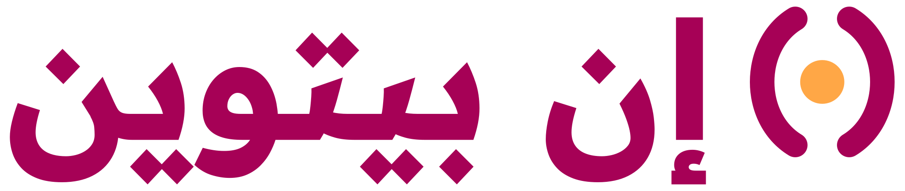
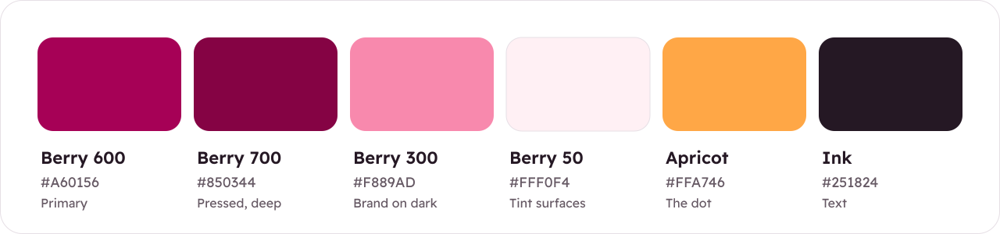
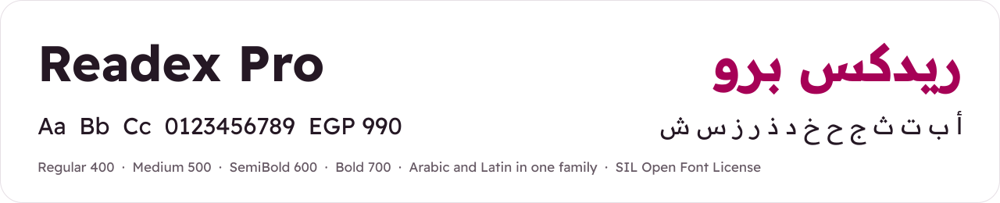

# inBetween brand

  
  &nbsp;&nbsp;&nbsp;
  

inBetween is **friendly and trustworthy**: warm berry, one apricot dot, rounded shapes and plain words. This page covers what you need to use the brand in the product, in docs and in marketing. The source files are in this folder.

## The idea

The symbol is two rounded brackets with a dot between them: **( • )**. The brackets are the two people, the owner and the renter. The apricot dot is the thing that passes between them, and the payment inBetween holds until it does.

- **Name:** inBetween, one word, with a lowercase `in` and a capital `B`. Never "In Between", "INBETWEEN" or "Inbetween".
- **Arabic name:** إن بيتوين. Use it in Arabic UI and marketing. Never translate it to "بين".
- **Tagline:** "Rent anything, from a needle to a rocket." / "أجّر أي حاجة، من الإبرة للصاروخ."

## Logo

| Preview | File | Use it for |
| --- | --- | --- |
|  | [`inbetween-lockup.svg`](logo/inbetween-lockup.svg) | The default, on white or any light background |
|  | [`inbetween-lockup-ar.svg`](logo/inbetween-lockup-ar.svg) | Arabic UI and marketing. The symbol sits on the right, where Arabic reading starts |
| (white) | [`inbetween-lockup-white.svg`](logo/inbetween-lockup-white.svg), [`inbetween-lockup-ar-white.svg`](logo/inbetween-lockup-ar-white.svg) | On berry backgrounds, dark surfaces, and photos with a dark overlay |
|  | [`inbetween-wordmark.svg`](logo/inbetween-wordmark.svg), [`-white`](logo/inbetween-wordmark-white.svg), [`-ink`](logo/inbetween-wordmark-ink.svg) | When the symbol already appears nearby. Use `-ink` for one-colour print |
|  | [`inbetween-symbol.svg`](logo/inbetween-symbol.svg), [`-white`](logo/inbetween-symbol-white.svg) | Small spaces: favicons, map pins, loading states |
|  | [`inbetween-app-icon.svg`](logo/inbetween-app-icon.svg) | App icon, favicon and social avatar |

The lettering is drawn as outlines from Readex Pro Bold, so the files need no fonts to display.

**Rules**

- The dot is always apricot, on every background. It is the only apricot in the logo.
- Leave clear space around the logo equal to the cap height of the `B`. The smallest sizes are 96 px wide for the lockup and 16 px for the symbol.
- Don't colour the brackets apricot. Don't outline the logo, add shadows, rotate it or stretch it. Don't put it on a busy photo without a dark overlay.
- Use the white logo on berry backgrounds. Don't put the berry logo on pink tints.

## Colour

Berry carries the brand, apricot is the spark, and everything else stays quiet.

| Token | Light | Dark | Use |
| --- | --- | --- | --- |
| `brand` | `#A60156` | `#F889AD` | Primary buttons, links, the active tab, selected dates. One primary button per view |
| `brand-solid` | `#A60156` | `#A60156` | Big moments only: the home hero, "booking confirmed", the app icon |
| `accent` | `#FFA746` | `#FFA746` | Small doses only: the logo dot, map pins, unread dots. Never for text |
| `ink` / `ink-muted` | `#251824` / `#665964` | `#F3ECF2` / `#B2A6B1` | Text and secondary text |
| `surface` / `surface-muted` | `#FFFFFF` / `#FAF5F9` | `#160B15` / `#231521` | Backgrounds |
| `line` / `line-strong` | `#E6DFE5` / `#8C7F8A` | — | Dividers / borders on inputs and other controls |
| `success` · `warning` · `danger` · `info` | `#007D50` · `#A14F09` · `#C2272D` · `#2769B7` | — | Booking states only. Always pair them with an icon and a word |

The full berry scale: 50 `#FFF0F4` · 100 `#FFDCE6` · 200 `#FFB9CE` · 300 `#F889AD` · 400 `#E24D87` · 500 `#C5146A` · **600 `#A60156`** · 700 `#850344` · 800 `#5F0930` · 900 `#3B091E` · 950 `#20050E`.

Contrast: berry 600 on white is 7.6:1, and berry 300 on the dark background is 8.4:1. Both pass WCAG AA for any text size.

## Typography

We use one font family for both scripts: [Readex Pro](https://fonts.google.com/specimen/Readex+Pro) (SIL Open Font License). Mixed Arabic and English then sit on one baseline. The fallbacks are Noto Sans Arabic, Segoe UI and system-ui.

- Never set Arabic text below 14 px, and keep a body line height of 26 px.
- Prices always show the currency and the unit, for example "EGP 300 / day". Western digits are the default in both languages.
- Use sentence case in English. Use all caps only in small label chips.

## Shape and layout

- Spacing is on a 4 px grid. The page gutter is 16 px on mobile and 24 px on desktop.
- Everything is rounded: 8 px for inputs, 16 px for cards and photos, 24 px for hero panels and modals. Buttons, the search bar and badges are fully rounded pills.
- Arabic is the default and reads right to left. Lay out with logical start/end properties, and mirror arrows and chevrons, but not the logo, numbers or media controls.

## Voice

Talk like a helpful neighbour who is careful with money.

- Arabic is Egyptian colloquial, warm and short: "احجز وادفع بأمان". English is plain and direct: "Your payment is held until pickup."
- Say what happens to the money at every step: "We'll release EGP 810 to Mona after pickup."
- Buttons name the action, like "Request to book", "Pay EGP 990" or "Confirm pickup". Never "Submit" or "OK".
- Error messages say what went wrong and what to do next. No emoji in the product UI.
